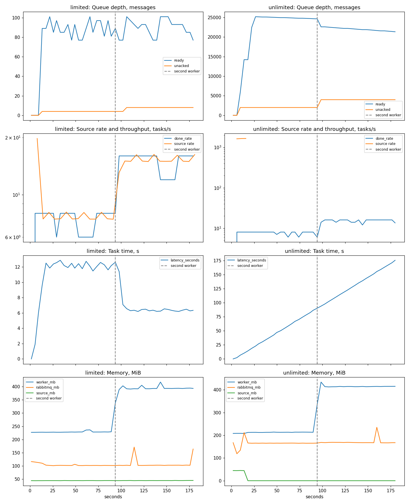

# Resume Classifier

MLOps-система классификации резюме соискателей по профессиональным направлениям.

## Задача

Автоматически определять профессиональное направление кандидата по его резюме: опыту работы,
образованию, навыкам и другим характеристикам.

## Данные

28 935 резюме и около 48 исходных признаков:

- **табличные и категориальные** — возраст, пол, опыт работы, уровень образования, зарплатные
  ожидания, желаемый график, готовность к переезду и командировкам, знание языков, наличие
  водительских прав и другие;
- **вложенные** — опыт работы (должности, компании, продолжительность, обязанности, достижения)
  и образование (учебные заведения, специальности, квалификации);
- **текстовые** — желаемая должность, описания обязанностей и достижений, профессиональные и
  гибкие навыки.

Датасет содержит персональные данные и в репозитории не хранится. Откуда его взять и как он
готовится к обучению — в [`data/README.md`](data/README.md). В git лежит только учебный набор.

## План

Проект строится как полный ML-пайплайн:

- подготовка и валидация данных;
- обучение и сравнение моделей;
- версионирование данных и моделей;
- автоматизация обучения и тестирования;
- развёртывание модели в виде API;
- мониторинг качества модели и состояния сервиса.

## Ветки

Каждая часть проекта сделана в отдельной ветке и влита в `main` через pull request.
Подробности — в README соответствующей ветки.

| Ветка | Что сделано | PR |
|---|---|---|
| [`feature/app`](../../tree/feature/app) | асинхронный веб-сервис со служебными эндпоинтами, тесты | [#1](../../pull/1) |
| [`feature/docker-ci`](../../tree/feature/docker-ci) | Docker, docker compose с PostgreSQL, pre-commit, CI | [#2](../../pull/2) |
| [`feature/cd`](../../tree/feature/cd) | CD: публикация версионированного образа в Docker Hub | [#3](../../pull/3) |
| [`feature/multiarch`](../../tree/feature/multiarch) | сборка образа под amd64 и arm64, релиз 0.1.1 | [#4](../../pull/4) |
| [`feature/ml-data`](../../tree/feature/ml-data) | подготовка данных, разбиение на train / validation / test, учебный набор | [#17](../../pull/17) |
| [`feature/mlflow-server`](../../tree/feature/mlflow-server) | MLflow Tracking Server с отдельными Backend Store и Artifact Store | [#18](../../pull/18) |
| [`feature/ml-training`](../../tree/feature/ml-training) | EDA, эксперименты, метрики, реестр моделей и alias `champion` | [#19](../../pull/19) |
| [`feature/process`](../../tree/feature/process) | загрузка модели из реестра, `POST /process`, релиз 0.2.0 | [#20](../../pull/20) |
| [`feature/dataset-versions`](../../tree/feature/dataset-versions) | версии датасета v1 и v2, обучение на версии под своим alias | [#23](../../pull/23) |
| [`feature/model-aliases`](../../tree/feature/model-aliases) | модели всех alias при старте, выбор модели в запросе, список версий | [#24](../../pull/24) |
| [`feature/evaluation`](../../tree/feature/evaluation) | метрики модели на test выбранной версии датасета, релиз 0.3.0 | [#26](../../pull/26) |
| [`feature/task-queue`](../../tree/feature/task-queue) | RabbitMQ, воркер на FastStream, `POST /api/v1/tasks`, DLQ, 503 при перегрузке | [#27](../../pull/27) |
| [`feature/source`](../../tree/feature/source) | источник задач, который замедляется по сигналу брокера | [#28](../../pull/28) |
| [`feature/experiment`](../../tree/feature/experiment) | эксперимент с ограничением нагрузки и без, релиз 0.4.0 | [#29](../../pull/29) |

## Как ведётся разработка

- `main` — актуальный код; изменения попадают в него через pull request. Исключение — коммит
  `cf81246` с workflow автозакрытия PR: он должен был оказаться в `main` раньше PR, которые
  проверяет, поэтому залит напрямую.
- Push в ветку и pull request запускают CI: линтер, тесты, smoke-тест.
- Merge в `main` и тег версии `vX.Y.Z` запускают CD: образ публикуется в Docker Hub —
  [`asebaie/resume-classifier`](https://hub.docker.com/r/asebaie/resume-classifier).
- Версия проекта хранится в `pyproject.toml`, релиз — git-тег с той же версией.
- README в `main` меняется только из веток `docs/...`: у остальных веток свой README, и CI не
  даст случайно перенести его в `main`.

## Быстрый старт

```bash
cp .env.example .env
TRAIN_DATA_PATH=/input/resumes_demo.csv docker compose up -d --build
```

Команда поднимает API, воркер, RabbitMQ, PostgreSQL и MLflow, обучает модели на учебном наборе
и загружает их в воркер. Для обучения на настоящих данных файл нужно положить в
`data/cv_target.csv` и запустить `docker compose up -d --build` без `TRAIN_DATA_PATH`.

Классификация резюме идёт через очередь:

```bash
curl -X POST http://localhost:8000/api/v1/tasks -H 'Content-Type: application/json' -d '{"text": "Python, FastAPI, PostgreSQL"}'
curl http://localhost:8000/api/v1/tasks/<id>
```

Нагрузочный сценарий — пакетный скоринг файла (нужен `data/evaluation/full.csv`, см.
[`data/README.md`](data/README.md)):

```bash
docker compose --profile load up -d source
```

Документация API — http://localhost:8000/docs, интерфейс MLflow — http://127.0.0.1:5050,
веб-интерфейс RabbitMQ — http://127.0.0.1:15672.

## Противодавление

Задачи идут по цепочке «источник или API → очередь RabbitMQ на 100 задач → воркеры → PostgreSQL».
Как устроен каждый механизм и почему выбран именно он — в README веток
[`feature/task-queue`](../../tree/feature/task-queue) и [`feature/source`](../../tree/feature/source).

- **Брокер → воркер:** `prefetch_count` = 4 = размер пула потоков воркера, inference идёт в пуле и
  не блокирует event loop.
- **Воркер → источник:** очередь ограничена, при заполнении брокер отклоняет публикацию
  (publisher confirms + `x-overflow: reject-publish`), источник ждёт с растущей паузой и повторяет.
- **Граница системы:** клиента API замедлить нельзя, поэтому при полной очереди он сразу получает
  `503` и `Retry-After` — это сброс нагрузки, а не противодавление.
- **Надёжность:** ack после записи результата, 3 повтора с паузой, затем `tasks.dlq`;
  идемпотентность по первичному ключу задачи; graceful shutdown по SIGTERM.

### Эксперимент

Два прогона по 3 минуты: с ограничениями и без, второй воркер подключается на 90-й секунде.
Подробности и методика — в [`feature/experiment`](../../tree/feature/experiment).



| Показатель | С ограничениями: 1 → 2 воркера | Без ограничений: 1 → 2 воркера |
|---|---|---|
| Глубина очереди | 77–101 при лимите 100 | до 25 200 |
| Скорость источника | ≈ 8 → ≈ 16 задач/с | ≈ 1650 задач/с |
| Пропускная способность | 8 → 16 задач/с | 8 → 16 задач/с |
| Время выполнения задачи | ≈ 12,5 → ≈ 6,3 с | растёт без предела, 175 с к концу |
| Память RabbitMQ | ≈ 100 МБ | ≈ 165 МБ и растёт с очередью |

**Выводы.** С ограничениями очередь не выходит за лимит, скорость источника сама подстраивается
под пропускную способность воркеров, а второй воркер ускоряет и обработку, и источник без
изменения кода. Без ограничений источник за секунды перекладывает всю работу в брокер: растут
очередь, память брокера и время ожидания каждой задачи.
